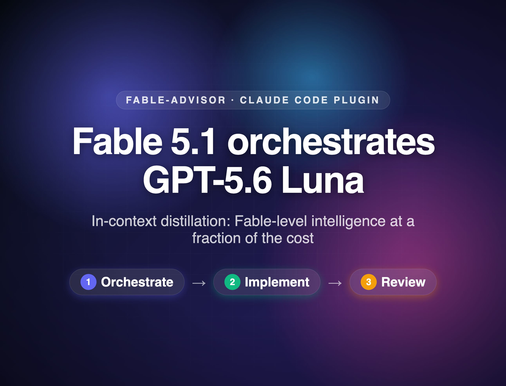

# Fable Advisor

**Your session runs the show on whatever model you like. Opus 5.5 workers do the typing, and Fable 5.2 reviews before anything ships.**

<a href="https://github.com/DannyMac180/fable-advisor/raw/main/assets/fable-advisor-demo.mp4"></a>

<p align="center"><em>▶ 30s demo (v5, Codex lanes) — orchestrator → worker implements → Fable reviews</em></p>

Claude Code lets every subagent run on a different model — and lets the session itself run on a different model than its subagents. This plugin exploits that with the **architect pattern**: your session — on whichever model you think is best — acts as the architect. It owns requirements, decomposition, specs, and verification, decides which implementation to hand to which lane, and gets a clean-context **Fable 5.2** review of the finished work before calling anything done:

| Lane | Model · default effort | Invocation | Route here when |
|---|---|---|---|
| Routine | **Opus 5.5** · `medium` | `implementer` agent (default) | The spec fully determines the outcome |
| Complex | **Opus 5.5** · `high` | `implementer` agent | Judgment the spec can't capture decides the outcome: subtle concurrency, hard debugging, security-sensitive paths, wide refactors |
| Review | **Fable 5.2** · session effort | `fable-advisor` agent | Commitment boundaries, and **always once at the end** — the advisor reviews the accumulated changes before the architect reports done |

**Both worker lanes are one agent at two efforts.** The architect passes the model and effort on every call, and the spec's `LANE:` line names the lane and effort the worker runs at (the lane default, or an override from `low … max`). The session and the advisor run at whatever `/effort` you set.

**You can see which model runs each step.** The orchestration skill labels every delegation with its model and effort (`Opus 5.5 · medium: add pagination`, `Fable 5.2: final review`), and every worker report names the model ID that actually ran, so a silent fallback shows up.

Tokens route by price: the session emits judgment and specs, the Opus workers emit the code at half Fable's per-token price ($4/$20 vs $8/$40 per MTok), and the Fable premium is spent where it changes outcomes: the architecture and the final review.

The plugin ships the **orchestration skill** — the doctrine that gives the session what delegation costs and when it pays, when to use each lane and effort level, the six-part spec that makes context-free delegation safe, and the verification rules that keep every worker honest. It's written for a Fable 5.2 architect: it gives the cost facts and leaves the call to the model, rather than fixed rules like "never type code yourself".

## Go deeper

I write [**Attention Heads**](https://attentionheads.substack.com/?utm_source=github&utm_medium=readme&utm_campaign=fable-advisor) — deep, evidence-backed writing on AI, cognition, and agentic engineering. The **Agentic Engineering Field Notes** series is where I publish practical advice on the craft of using AI. [Subscribe](https://attentionheads.substack.com/subscribe?utm_source=github&utm_medium=readme&utm_campaign=fable-advisor) to get new posts to your inbox.

## Install

```
claude plugin marketplace add DannyMac180/fable-advisor
claude plugin install fable-advisor@fable-advisor
```

Updating an existing installation to the latest release:

```
claude plugin marketplace update fable-advisor
claude plugin update fable-advisor@fable-advisor
```

Then pick whichever model you want as the architect — the plugin doesn't choose it for you. The workers default to Opus 5.5 and the advisor to Fable 5.2 regardless.

**Lite mode — one file, 30 seconds.** Don't want the full pattern? Copy [`agents/fable-advisor.md`](agents/fable-advisor.md) into `~/.claude/agents/` and keep your session on Sonnet. You get advisor consults at commitment boundaries without the orchestration layer (see "Advisor-only mode" below).

## Requirements

- **Claude Code ≥ 2.1.170** with a subscription that includes Fable (Pro, Max, Team, or Enterprise — all current consumer plans qualify). The agents use the `opus` and `fable` aliases, which resolve to Opus 5.5 and Fable 5.2 (checked on Claude Code 2.1.316).
- **No Fable access** (e.g. API-key billing)? Run `/fable-advisor:setup` and pick Opus 5.5 for the reviewer. In lite mode (the agent file alone, no skill), change `model: fable` → `model: opus` in `agents/fable-advisor.md` instead. Same pattern; the review becomes a clean-context Opus check.
- **Nothing else.** v7 workers are Claude Code subagents — no Codex CLI, no extra login.
- **Optional: the [Codex plugin for Claude Code](https://github.com/openai/codex-plugin-cc)** (`/plugin marketplace add openai/codex-plugin-cc`, then `/plugin install codex@openai-codex`). When it's enabled, the orchestration skill runs `/codex:adversarial-review` ahead of the Fable review on security-sensitive, migration, and API-shape deliverables. It's the only check in the pattern from outside the Claude family. Not a dependency.
- Heads-up: if a pinned Claude model isn't available on your account, Claude Code silently falls back to your session model. The implementer's report names the model ID that actually ran, and the architect flags a mismatch.

Model resolution order in Claude Code: `CLAUDE_CODE_SUBAGENT_MODEL` env var → per-invocation `model` parameter → agent frontmatter → session model. **Don't set `CLAUDE_CODE_SUBAGENT_MODEL`** (check the `env` block of `~/.claude/settings.json` too): it overrides every lane pin, so your "Opus" workers and "Fable" review silently run on one model. `/fable-advisor:setup` warns if it's set.

## Choose your lane models

Run `/fable-advisor:setup` once after installing. It asks which model you want for each lane, with the recommended one listed first: routine (Opus 5.5 · `medium`), complex (Opus 5.5 · `high`), and reviewer (Fable 5.2). For the two worker lanes it also asks the default effort. It saves your choices to `~/.claude/fable-advisor/lanes.json`, and the orchestration skill passes them on every call. The model list lives in `config/models.json`; lanes accept only Claude Code's model aliases (`opus`, `sonnet`, `haiku`, `fable`), because a full model ID would fall back silently. A v6 `lanes.json` (Codex lanes) is ignored until you re-run setup.

## Use it

With the plugin installed, just ask for work — the orchestration skill routes it:

```
Add rate limiting to our public API. Design it, delegate the
implementation, and verify the evidence before you call it done.
```

The architect writes the spec, picks the lane and, if needed, overrides its effort (rate limiting touches concurrency — a good case for the complex lane, maybe raised to `xhigh`), reads the diff and verification evidence when the report comes back, sends the finished work to `fable-advisor` for the final review, and only then reports done.

### `/fable-advisor:build` — the workflow path

For a build that splits into several independent pieces, run it as a workflow:

```
/fable-advisor:build Add rate limiting and request logging to the public API
```

The session writes up to five independent specs per round. A Claude Code Workflow runs each one on its pinned lane in its own git worktree under `.claude/worktrees/`, on its own branch, retrying a failed spec once. The session then:
- merges the branches into your current branch (`--no-ff`, local commits, never pushed);
- runs the full checks on the merged tree;
- gets the Fable review;
- removes the merged worktrees.

Failed or unmerged worktrees, and leftovers from earlier runs, are listed and removed only if you say yes.

Workers run in the background and can't ask for permission. Allow each spec's verification command, `git add` and `git commit` (`/build` offers to add them to `.claude/settings.local.json`), or those specs come back `blocked`. Workflows only run when you invoke `/build` or ask for one; otherwise the architect sends parallel implementer calls.

To make the doctrine always-on, add one line to your project's `CLAUDE.md`:

```
You are the architect. Use the orchestration skill to decide, from its
cost table, which implementation to hand to the implementer lanes and
which to do yourself. Label each delegation with its model, check the
evidence before accepting a worker's report, and get a fable-advisor
review before reporting any deliverable done.
```

## Commitment boundaries and the final review

Even the architect gets a second opinion. The `fable-advisor` agent is a read-only skeptic on Fable 5.2, working in a clean context. It's consulted before architecture decisions, migrations, API designs, whenever a problem has resisted two attempts, and **always once at the end of a deliverable**, where it reads the accumulated diff with fresh eyes, against the stated goal rather than the conversation, and returns ship / fix-first / rethink. It never implements. It sees the code fresh, without your conversation's accumulated assumptions — that context-clean skepticism is what the final review buys. For a review from outside the Claude family on top, the optional Codex plugin's `/codex:adversarial-review` slots in just before it.

## Advisor-only mode (the original pattern)

The minimal arrangement, for when you'd rather skip the orchestration layer: run the session on Sonnet and consult `fable-advisor` only at commitment boundaries.

```
Migrate our checkout sessions from Postgres to Redis — plan it,
consult your advisor before committing, then implement.
```

A typical consult costs cents. To make it automatic, add to your project's `CLAUDE.md`:

```
Before committing to any architecture decision, migration, or refactor
touching 3+ files, consult the fable-advisor agent and act on its verdict.
```

## FAQ

**Is this Anthropic's "advisor tool"?** No — that's a server-side API feature. These are plain Claude Code subagents plus a skill: readable, editable, no beta flags.

**Does this work on claude.ai?** No — subagent model routing is Claude Code only (CLI, desktop, VS Code, web).

**Why not just let Fable (or your session model) write the code too?** You can. Fable is excellent. It's also the most expensive model per token, and most of a session's tokens are implementation mechanics that Opus 5.5 handles at half the per-token price. Spend the premium where it changes outcomes: the architecture and the final review.

**Upgrading from v6?** v7 drops the Codex lanes: **`luna-implementer` and `sol-implementer` are removed**, replaced by one Claude-native **`implementer`** agent (Opus 5.5) on two lanes, routine at `medium` and complex at `high`. Nothing needs the Codex CLI any more. `lanes.json` moves to version 2 — re-run `/fable-advisor:setup`; a v6 file is ignored until you do. The advisor is now Fable 5.2. What you give up is v6's cross-vendor implementation: every line of code now comes from a Claude model, and the optional `/codex:adversarial-review` is the only check from another family. Update anything (a `CLAUDE.md`, a script) that calls the old agents by name.

**Upgrading from v5?** v6 stops telling you which model to run the session on: use whichever you think is best (I use Opus 5.5). The lanes move to GPT-6: **`codex-implementer` is renamed `luna-implementer`** and runs `gpt-6-luna`, and `sol-implementer` runs `gpt-6-sol`. Each lane now has a default effort (Luna `max`, Sol `high`), so the spec's `REASONING:` line is only needed to override it. Delegations are labelled with the model running them, and the agents have UI colours. Update anything (a `CLAUDE.md`, a script) that calls `codex-implementer` by name.

**Upgrading from v4?** v5 moves the session architect from Opus to **Fable 5.1**, replaces the Fable 5 `fable-implementer` lane with **`sol-implementer`** (GPT-5.6 Sol via Codex), and **unpins reasoning effort everywhere** — the architect names it per task in a new sixth spec line. The advisor is now Fable 5.1. The Codex plugin integration is new and optional. If you still want a Claude implementation lane, grab [`fable-implementer.md` from the v4.0 tree](https://github.com/DannyMac180/fable-advisor/blob/ad2bdc3/agents/fable-implementer.md).

**Upgrading from v3?** v4 moved the architect to Opus, removed the Grok 4.5 lane, and made `codex-implementer` the default typing lane; if you still want the Grok lane, grab [`grok-implementer.md` from the v3.1 tree](https://github.com/DannyMac180/fable-advisor/blob/b3b50a9/agents/grok-implementer.md).

**Why did the GPT lanes go?** Simpler setup and one billing relationship: Claude Code subagents need no second CLI, login, or prompt-injection-proof preamble, and Opus 5.5 does the typing at half Fable's price. The cost is vendor diversity in the code itself. If you want it back for a deliverable, run `/codex:adversarial-review` on the diff, or grab [`luna-implementer.md` from the v6.1 tree](https://github.com/DannyMac180/fable-advisor/blob/9df042b/agents/luna-implementer.md).

## License

MIT
